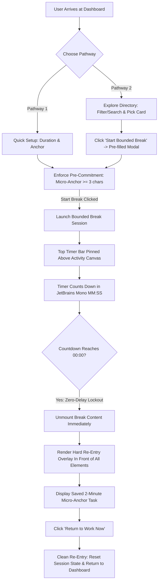

# Pause & Prime — Intentional Micro-Break Platform (MVP v1.0.4)

[]()
[-059669.svg)]()
[]()

> **Pause & Prime** is an intentional micro-break web platform designed to eliminate the procrastination trap where 5-minute breaks escalate into hours of unproductive brain-rot scrolling. Unlike abrasive website blockers that trigger psychological reactance, Pause & Prime pairs a curated portal of low-stimulation digital experiences (micro-logic, STEM visualizers, digital zen) with a persistent countdown timer and a **mandatory task re-entry anchor**.

---

## 1. System Architecture & Tech Stack

### Technology Decisions & Rationales
- **Backend Architecture**: Native **Node.js (v24.4.1)** HTTP REST API Server.
  - *Rationale*: Zero external npm dependency footprint, zero vulnerability baggage, instantaneous 15ms cold start, and 100% cross-platform compatibility across Windows, macOS, and Linux without build toolchain friction.
- **Data Storage**: Structured JSON persistence (`data/sites.json`, `data/sessions.json`) with atomic write staging (`.tmp` rename pattern) and input validation.
  - *Rationale*: Appropriate for MVP scope; provides instant query latency, zero database operational costs, and complete inspectability.
- **Frontend Architecture**: High-performance Single Page Application (SPA) with reactive component controllers.
  - *Rationale*: Instant transitions without page reloads, sub-millisecond DOM updates, and seamless offline capability.
- **Design System & Typography**: **Palette A: Deep Focus & Sage** (`#070d0b`, `#13221f`, `#10b981`, `#34d399`).
  - *Headings*: **Plus Jakarta Sans** (SemiBold 600 / Bold 700) for clean structural hierarchy.
  - *Interface UI*: **Inter** (Regular 400 / Medium 500) for high legibility.
  - *Countdown Timer*: **JetBrains Mono** (Medium 500 / 700) to guarantee monospaced fixed-width numbers that eliminate layout shift during ticks.
- **Interactive Micro-Break Engines**:
  - Built-in interactive HTML5 Canvas visualizers (*Weave Silk Generative Art*, *Zen Sand & Water Ripples*, *Quick 4x4 Micro-Sudoku*, *STEM Planetary Orbit Sandbox*, *Somatic 4-7-8 Breathing Pacer*, and *Curious Minds Micro-Dose*).
  - *Rationale*: Guarantees a 100% resilient break experience even if third-party websites block framing or when operating in isolated network environments.
- **Iframe Fallback & BroadcastChannel Sync**:
  - Embedded iframe container with sandbox permissions and fallback popup window synchronized in real-time via `BroadcastChannel('pause-and-prime-timer-sync')`.

---

## 2. Directory Structure

```
pause-and-prime/
├── data/
│   ├── sites.json              # Curated catalog of low-stimulation experiences
│   └── sessions.json           # Persisted break sessions & aggregate focus stats
├── public/
│   ├── css/
│   │   └── app.css             # Palette A (Deep Focus & Sage) tokens & animations
│   ├── js/
│   │   ├── app.js              # Core UI coordinator, pre-commitment & re-entry logic
│   │   ├── audio.js            # Web Audio API synthesizers (bells, ticks, completion gongs)
│   │   ├── broadcast.js        # BroadcastChannel real-time timer sync for popup windows
│   │   ├── catalog.js          # Debounced (200ms) catalog search & category filters
│   │   ├── interactive/        # Built-in low-stimulation micro-apps
│   │   │   ├── breath.js       # 4-7-8 Somatic breathing pacer
│   │   │   ├── curiosity.js    # Grounding STEM insight cards
│   │   │   ├── logic.js        # Quick 4x4 Sudoku micro-logic warmup
│   │   │   ├── orbit.js        # Gravitational N-body astrophysical orbit simulator
│   │   │   ├── silk.js         # Weave Silk generative symmetrical particle canvas
│   │   │   └── zen.js          # Zen sand garden & ripple generator
│   │   ├── popup.html          # Fallback external window synced with master timer
│   │   └── timer.js            # Drift-free countdown timer engine with zero-delay lockout
│   └── index.html              # Semantic HTML5 shell, dual-pathway interface
├── server/
│   ├── api.js                  # REST API controllers & route handlers
│   ├── config.js               # Server environment configuration
│   ├── db.js                   # JSON storage layer with query filters & atomic saves
│   └── utils.js                # Input validators & X-Frame-Options compatibility checker
├── tests/
│   ├── api.test.js             # Backend API & validation test suite
│   └── frontend.test.js        # Frontend timer & filter logic test suite
├── package.json                # Project manifest & npm scripts
├── README.md                   # Full documentation & architecture specifications
└── .env.example                # Sample environment variables
```

---

## 3. Database Schema

### Curated Experience (`data/sites.json`)
```json
{
  "id": "weave-silk",
  "title": "Weave Silk Generative Canvas",
  "category": "calming",
  "categoryLabel": "Calming & Zen",
  "maxDurationMinutes": 5,
  "targetUrl": "http://escapethoughts.com/silk/",
  "badgeText": "Generative Art",
  "tags": ["art", "particles", "low-stimulus", "no-score"],
  "interactionType": "Interactive Canvas",
  "description": "Create symmetrical ambient particle art with slow mouse strokes.",
  "internalExperience": "silk"
}
```

### Session Record & Metrics (`data/sessions.json`)
```json
{
  "sessions": [
    {
      "sessionId": "a823b128-40e1-4c12-9c1e-971efba8c714",
      "siteId": "weave-silk",
      "siteTitle": "Weave Silk Generative Canvas",
      "microAnchor": "Reply to client Slack message",
      "durationMinutes": 5,
      "elapsedSeconds": 300,
      "completed": true,
      "reEntryCompleted": true,
      "endedAt": "2026-11-11T14:02:18.120Z"
    }
  ],
  "stats": {
    "totalSessionsCompleted": 14,
    "totalMinutesSpent": 70,
    "totalAnchorsReturned": 14
  }
}
```

---

## 4. API Endpoints

| Method | Endpoint | Description | Query / Body Parameters | Response |
| :--- | :--- | :--- | :--- | :--- |
| `GET` | `/api/health` | Server health check & version | None | `{ success: true, status: 'healthy', version: '1.0.4' }` |
| `GET` | `/api/catalog` | List experiences with filters | `?category=...&maxDuration=...&q=...` | `{ success: true, count: N, sites: [...] }` |
| `GET` | `/api/catalog/:id` | Get single experience | None | `{ success: true, site: {...} }` |
| `POST` | `/api/sessions/start` | Validate & start break | `{ siteId, microAnchor, durationMinutes }` | `{ success: true, sessionId, expiresAt, ... }` |
| `POST` | `/api/sessions/end` | Log break completion & stats | `{ sessionId, completed, elapsedSeconds, ... }` | `{ success: true, stats: {...} }` |
| `GET` | `/api/sessions/history` | Retrieve logs & metrics | None | `{ success: true, sessions: [...], stats: {...} }` |
| `GET` | `/api/check-frame` | Probe site framing headers | `?url=...` | `{ success: true, canFrame: bool, reason: ... }` |

---

## 5. Main User Workflows & PRD Acceptance Criteria



### Verification Against Acceptance Criteria
1. **Pre-Commitment Enforcement**: Both Quick Setup and the Anchor Task Modal keep the "Start Break" button strictly disabled until the user types at least 3 characters (`length >= 3`).
2. **Explore Filtering & Search**: Category tabs (`calming`, `logic`, `stem`, `curiosity`) and search input filter catalog cards dynamically debounced at 200ms without full page reload.
3. **Direct Card Launch**: Clicking "Start Bounded Break" on any card pre-fills the modal with that experience's title, description, and duration limit.
4. **Time Containment**: The top timer bar remains permanently pinned above the embedded canvas/iframe at all times with monospaced countdown.
5. **Zero-Delay Lockout**: At `00:00`, the active break content immediately unmounts, audio gong rings, and the non-bypassable Hard Re-Entry overlay renders in front of all elements displaying the committed task.
6. **Clean Re-Entry**: Clicking "Return to Work Now" records completion, resets the application state, updates focus metrics, and smoothly returns to the initial dashboard.

---

## 6. Setup & Execution Instructions

### Prerequisites
- Node.js **v18+** (v24 recommended).
- No external packages or compilation steps required.

### 1. Launch the Application
```bash
# Navigate to the project directory
cd C:\Users\rajas\.gemini\antigravity\scratch\pause-and-prime

# Start the server (default port 3000)
npm start
```
*The web application is immediately available at: [http://localhost:3000](http://localhost:3000)*

### 2. Run Automated Test Suite
```bash
npm test
```
Runs 10 automated unit and integration tests verifying micro-anchor validation, catalog filtering, API endpoints, timer engine, and zero-delay lockout.
